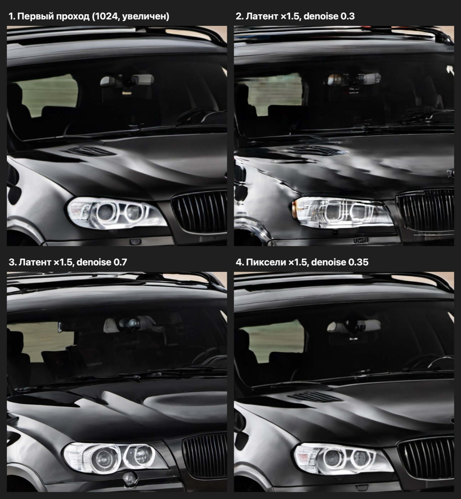

# Урок 1. Свой граф в интерфейсе

Как устроен граф ComfyUI, что делает каждый узел базовой генерации, как собрать граф с нуля и довести картинку вторым проходом.

Интерфейс — `http://<IP Windows>:8188` (у нас `http://192.168.1.105:8188`).

## Термины

| Термин | Что это |
| --- | --- |
| **Граф** (workflow) | схема из узлов и проводов; ComfyUI выполняет её целиком по кнопке Run |
| **Узел** (node) | один шаг обработки: входы слева, выходы справа, виджеты (поля настроек) посередине |
| **Провод** (link) | соединяет выход одного узла со входом другого; соединять можно только одинаковые типы, тип виден по цвету |
| **Чекпойнт** (checkpoint) | файл модели целиком: у нас `sd_xl_base_1.0.safetensors` |
| **MODEL** | нейросеть SDXL — та часть, что шаг за шагом убирает шум |
| **CLIP** | кодировщик текста: превращает промпт в числа, понятные модели |
| **VAE** | переводчик между пикселями и латентом: Decode — латент → картинка, Encode — картинка → латент |
| **CONDITIONING** | закодированный промпт, выход CLIP Text Encode |
| **Латент** (LATENT) | «сжатая картинка»: одна клетка латента — блок 8×8 пикселей, 1024×1024 — это латент 128×128. Модель работает только с латентом |
| **IMAGE** | обычная картинка в пикселях |
| **Промпт / негатив** | что рисовать / от чего отталкиваться |
| **Сэмплер** (KSampler) | сама генерация: из шума за N шагов делает латент картинки |
| **Seed** | номер начального шума; тот же граф с тем же seed повторяет картинку пиксель в пиксель |
| **CFG** | насколько строго следовать промпту |
| **Denoise** | какую долю шума добавить перед генерацией: 1.0 — с нуля, меньше — доработка готового |
| **Hires fix** | двухпроходная генерация: маленькая картинка → увеличение → второй проход дорисовывает детали |
| **Узел вывода** | узел, ради которого граф выполняется: Save Image, Preview Image |
| **Bypass / Mute** | временно обойти узел (вход идёт прямо на выход) / выключить его |

## Как граф выполняется

- **От вывода назад.** ComfyUI берёт узлы вывода (Save Image, Preview Image) и идёт от них назад по проводам. Узел, от которого нет пути к выводу, не выполняется вовсе.
- **Кэш.** Результат узла запоминается. При следующем запуске пересчитывается только то, что изменилось, и всё после него. Поменял seed — модель заново не грузится, считаются KSampler и дальше. Поменял второй проход — первый берётся из кэша. Поэтому первая картинка ~30 с, следующие ~10 с.
- **Во время обучения LoRA** генерация отвечает `423`: в 10 ГБ видеопамяти они вместе не помещаются.

## Базовый граф: txt2img

Меню (логотип слева вверху) → **Browse Templates** → **local-comfyui** → `txt2img` → **Run**.

```
Load Checkpoint ─ MODEL ─────────────────────────────┐
                ├ CLIP ─ Prompt   (CLIP Text Encode) ─┤ positive
                ├ CLIP ─ Negative (CLIP Text Encode) ─┤ negative
                │       Empty Latent Image ───────────┤ latent_image
                │                                  KSampler ─ LATENT ─ VAE Decode ─ IMAGE ─ Save Image
                └ VAE ─────────────────────────────────────────────────┘
```

| Узел | Что делает |
| --- | --- |
| **Load Checkpoint** | загружает модель и выдаёт три выхода: MODEL, CLIP, VAE |
| **CLIP Text Encode** ×2 | текст → CONDITIONING; один для промпта, второй для негатива |
| **Empty Latent Image** | пустой латент нужного размера; `batch_size` — сколько картинок за раз |
| **KSampler** | генерация |
| **VAE Decode** | латент → пиксели |
| **Save Image** | сохраняет в `data/output/<префикс>_NNNNN_.png`; `txt2img/image` — подпапка и префикс |
| **Preview Image** | то же, но только показывает в интерфейсе, на диск не пишет |

### Поля KSampler

| Поле | Что значит | С чего начать |
| --- | --- | --- |
| `seed` | начальный шум → композиция, ракурс, раскладка цветов | любое |
| `control_after_generate` | что сделать с seed после запуска: `randomize` — новый, `fixed` — оставить | `fixed`, когда что-то подбираешь |
| `steps` | число шагов | 20–30 |
| `cfg` | строгость следования промпту; выше — пережжённые цвета | 5–8 для SDXL |
| `sampler_name` | как сделать один шаг | `dpmpp_2m` |
| `scheduler` | как распределить силу шума по шагам | `karras` |
| `denoise` | доля шума: 1.0 — генерация с нуля | 1.0 для первого прохода |

### Размер картинки

SDXL обучен около 1 мегапикселя. На больших холстах (1920×1080 — уже 2 Мп) модель не держит композицию: двоятся объекты, картинка расползается и мылится.

| Формат | Размер |
| --- | --- |
| квадрат | 1024×1024 |
| 4:3 / 3:4 | 1152×896 / 896×1152 |
| 3:2 / 2:3 | 1216×832 / 832×1216 |
| 16:9 / 9:16 | 1344×768 / 768×1344 |

Нужен большой размер — генерируй около 1 Мп и увеличивай вторым проходом: 1280×720 ×1.5 = ровно 1920×1080.

### Sampler и scheduler

Генерация — это 20–30 шагов от шума к картинке. **Sampler** решает, *как* сделать один шаг; **scheduler** — *как распределить* силу шума по шагам: крупные изменения в начале, тонкие детали в конце.

| Sampler | Что даёт |
| --- | --- |
| `euler` | простой, быстрый, мягковатый; хорош как точка отсчёта |
| `dpmpp_2m` | хорошее качество за 20–30 шагов; **выбор по умолчанию** |
| `dpmpp_2m_sde`, `dpmpp_3m_sde` | больше деталей и фактуры; нужно 30+ шагов |
| `*_ancestral` (`euler_ancestral`…) | подмешивают свежий шум каждый шаг: больше разнообразия, но картинка меняется даже от числа шагов — для поиска идей, не для воспроизводимости |
| `heun`, `dpmpp_sde`, `dpm_2` | два вызова модели на шаг: точнее, вдвое медленнее |
| `lcm` и подобные | только для специальных быстрых моделей; с обычным SDXL — каша |

| Scheduler | Что даёт |
| --- | --- |
| `normal`, `simple` | шаги равномерно |
| `karras` | больше шагов в конце, на деталях; с `dpmpp_*` обычно лучший |
| `exponential`, `beta` | похожи на karras; `exponential` — пара для `*_sde` |
| `sgm_uniform` | для turbo/lightning-моделей |

## Seed и промпт: как подбирать

Картинка = промпт + seed + настройки. Seed отвечает за композицию, промпт — за содержание и стиль.

- **Seed `fixed`, меняешь промпт** — композиция и ракурс в основном остаются, видно, что делает каждое слово (`black bmw` → `red bmw` — та же сцена, другой цвет). Так учишься, как модель читает слова.
- **Промпт тот же, меняешь seed** — видно разброс промпта: хорош ли он на любом шуме или только на удачном. Если 4 seed из 4 хороши — промпт надёжный.

Порядок работы: перебрать seed (`batch_size` 4 даёт четыре варианта за запуск) → найти композицию → зафиксировать seed → доводить промпт.

## Негатив: подчищает, а не стирает

На каждом шаге KSampler считает два варианта — «по промпту» и «по негативу» — и сдвигает картинку от второго к первому с силой `cfg`. Негатив отталкивает от черт, но не вырезает части объекта.

- **То, что входит в само понятие, негатив не уберёт.** `car` без колёс и крыши — уже не машина. Описывай нужное в промпте: без крыши — `convertible`, без колёс — `hovercar, floating above the ground`.
- **Стиль задаётся в промпте.** SDXL по умолчанию рисует `black bmw car` фотографией; `realistic` в негативе этого не перебьёт. Работает так: `black bmw car, flat vector illustration, cartoon, bold outlines, simple background`, а негатив `photo, realistic, 3d render` это усиливает.
- **Негатив хорош для необязательного:** `blurry`, `text`, `watermark`, лишние люди, фон.

Промпт говорит, *что* рисовать; негатив только подчищает.

## Сборка графа с нуля

Новый граф — меню → New или «+» на вкладке. Узлы добавляются двумя способами:

- **двойной клик** по пустому месту → поиск по названию;
- **провод от выхода, отпущенный на пустом месте**, → поиск сразу только подходящих узлов. Самый быстрый способ: от `CLIP` — CLIP Text Encode, от `LATENT` — VAE Decode, от `IMAGE` — Save Image.

Порядок: Load Checkpoint → от `CLIP` дважды CLIP Text Encode → Empty Latent Image → KSampler (model, positive, negative, latent_image) → от его `LATENT` VAE Decode (`vae` — от чекпойнта) → от `IMAGE` Save Image.

У одного выхода может быть сколько угодно проводов: один VAE Decode может кормить и Preview Image, и следующий узел.

**Называй узлы.** Двойной клик по заголовку — переименовать: `Prompt`, `Negative`, `Pass 1`, `Pass 2`, `Size`. В интерфейсе это удобство, а в API — необходимость: клиент находит узлы по заголовку (`--set Prompt.text="…"`), и два узла с одинаковым заголовком `KSampler` он не различит.

## Приёмы интерфейса

| Действие | Как |
| --- | --- |
| запустить | Ctrl+Enter или Run |
| двигать холст / масштаб | тянуть пустое место (или Space + мышь) / колесо |
| выделить несколько | Ctrl + рамка |
| копировать / вставить с проводами | Ctrl+C / Ctrl+Shift+V |
| выключить узел | Ctrl+M (mute) или Ctrl+B (bypass) |
| группа | выделить → Ctrl+G |
| переименовать узел | двойной клик по заголовку |
| увидеть новые модели и LoRA | R |

На Маке сочетания обычно работают и с Cmd, и с Ctrl; полный список — настройки (шестерёнка) → Keybinding.

**Граф вшит в каждую PNG.** Перетащи картинку из `data/output` на холст — откроется граф, которым она сделана, со всеми настройками.

**Сохранение:**

| Как | Куда и зачем |
| --- | --- |
| Save (Ctrl+S) | `data/user` на Windows, боковая панель Workflows |
| File → Export | `.json` для интерфейса — хранить в репозитории проекта |
| File → Export (API) | граф для `POST /prompt` — урок 3 |
| `client.mjs pull <имя>` | граф последнего запуска из интерфейса, сразу оба формата |
| `client.mjs push <граф.ui.json>` | граф с Мака в панель Workflows |

## Двухпроходная генерация (hires fix)

Идея: сгенерировать около 1 Мп, где SDXL силён, увеличить и вторым проходом с небольшим denoise дорисовать детали. Второй проход не придумывает картинку заново — он видит увеличенную и уточняет её.

### Вариант 1: увеличение латента

```
Pass 1 (denoise 1) → Upscale Latent By (×1.5) → Pass 2 (denoise 0.55–0.7) → VAE Decode → Save Image
```

`nearest-exact` увеличивает латент повтором соседних клеток, без сглаживания — после декодирования это блоки по 8–16 пикселей. Второй проход с малым denoise не успевает их исправить, поэтому рабочий denoise — от 0.55. Цена: при 0.7 модель перерисовывает детали, композиция остаётся, а фары, решётка, лица уже другие. `bilinear` вместо `nearest-exact` даёт вместо блоков мыло, порог тот же.

### Вариант 2: увеличение в пикселях (лучше)

```
Pass 1 → VAE Decode → Upscale Image By (lanczos ×1.5) → VAE Encode → Pass 2 (denoise 0.3–0.45) → VAE Decode → Save Image
```

Картинка увеличивается сглаживающим фильтром, второму проходу остаётся только дорисовать детали. Можно держать denoise 0.3–0.4: картинка становится чётче, а детали первого прохода сохраняются.

### Сравнение

Один участок, один seed, `dpmpp_2m` + `karras`:



1. **Первый проход** (1024, растянут) — исходник.
2. **Латент, 0.3** — капот волнами, фара в кашу: блоки `nearest-exact`, второй проход их не исправил.
3. **Латент, 0.7** — чётко, но машина другая: фары сдвинулись, на капоте горб, внизу лишняя противотуманка.
4. **Пиксели, 0.35** — те же фары, решётка, воздухозаборник, только чётче.

Латент + высокий denoise — «перерисовать»; пиксели + низкий denoise — «дорисовать».

Специальные модели-увеличители (ESRGAN и подобные) у нас не стоят: они чаще распространяются в `.pth`, а мы берём только `.safetensors`.

## Упражнения

1. **Шаблон.** Открыть `txt2img`, запустить, найти результат в `data/output/txt2img/`. Перетащить PNG обратно на холст.
2. **Seed против промпта.** Seed `fixed`, менять только промпт. Потом промпт оставить, менять seed; `batch_size` 4.
3. **Сэмплеры.** Один seed и промпт через `dpmpp_2m`+`karras`, `euler`+`normal`, `dpmpp_2m_sde`+`karras`, `euler_ancestral`+`normal`. Смотреть на мелкие детали.
4. **Стиль в промпте.** Получить нефотографичную машину: стиль — в промпте, `photo, realistic` — в негативе.
5. **С нуля.** Собрать txt2img без шаблона, подписать узлы.
6. **Hires fix латентом.** Добавить Upscale Latent By и второй KSampler; превью первого прохода (второй VAE Decode → Preview Image); оба seed `fixed`; denoise 0.3 / 0.5 / 0.7.
7. **Hires fix в пикселях.** Заменить увеличение латента на VAE Decode → Upscale Image By → VAE Encode; denoise 0.25 / 0.35 / 0.45; сравнить с латентом на 0.7. Готовый граф — `hires-pixel` в панели Workflows.

## Частые ошибки

| Симптом | Причина |
| --- | --- |
| мыло, двоящиеся объекты | размер сильно больше 1 Мп |
| модель рисует что попало | в промпте заглушка (`subject` из шаблона) или слишком общие слова |
| негатив «не работает» | убираешь то, что входит в само понятие, или стиль задан только негативом |
| картинки не повторяются | `randomize` у seed — у одного из сэмплеров |
| блоки после второго прохода | увеличение латента `nearest-exact` + denoise ниже 0.55 |
| второй проход меняет детали | denoise слишком высокий |
| нехватка видеопамяти на больших размерах | VAE Decode → VAE Decode (Tiled) |
| `423` при запуске | идёт обучение LoRA |
