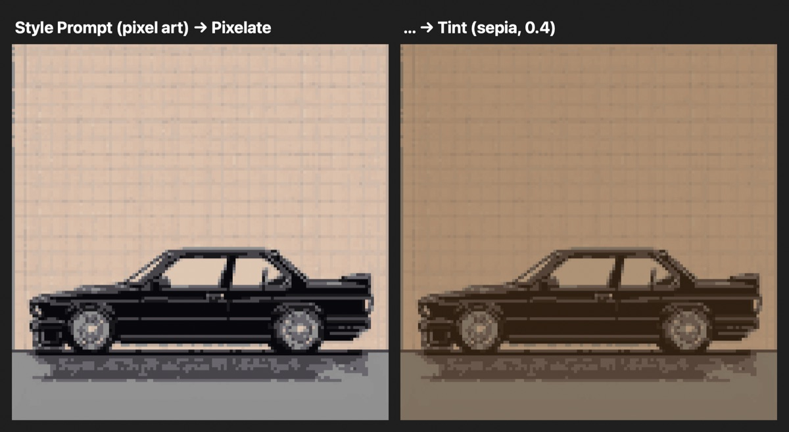

# Урок 2. Граф со своим узлом

Как написать свой узел ComfyUI, отправить его на сервер без перезапуска и собрать с ним граф. Учебный пакет — [nodes/](nodes/): проект `learn` с тремя узлами.

## Термины

| Термин | Что это |
| --- | --- |
| **Узел** | класс на Python: описывает входы, выходы и метод, который выполняется |
| **Встроенные узлы** | идут с ComfyUI: KSampler, VAE Decode, Save Image… |
| **Узлы проекта** | проект хранит их у себя и присылает на сервер по API; на сервере — только их кэш |
| **Пакет узлов** | папка с `__init__.py`, где `NODE_CLASS_MAPPINGS`; рядом — свои модули |
| **`NODE_CLASS_MAPPINGS`** | словарь «имя узла → класс»; по нему ComfyUI находит узлы пакета |
| **`NODE_DISPLAY_NAME_MAPPINGS`** | как узлы называются в интерфейсе |
| **Тензор** | многомерный массив чисел torch; так ComfyUI передаёт картинки, маски и латенты |
| **Broadcasting** | torch сам «растягивает» меньший тензор на больший: цвет из трёх чисел — на каждый пиксель |
| **Виджет как вход** | любое поле узла можно подключить проводом, и значение придёт от другого узла |

## Как узлы проекта попадают на сервер

```
репозиторий проекта                       сервер (Windows, Docker)
  nodes/__init__.py   ── push-nodes ──▶   data/project_nodes/<проект>/
  nodes/*.py             (zip по API)     узлы <проект>.<узел>, без перезапуска
```

- Узлы регистрируются как `<проект>.<узел>`: `learn.Pixelate`. В интерфейсе — «Pixelate (learn)».
- Новая отправка заменяет пакет целиком. Тот же граф после неё пересчитывает узлы проекта и всё после них, а модели берёт из кэша.
- **Пакет с ошибкой не регистрируется** — на сервере остаётся прежний рабочий, в ответе конец traceback.
- Пакет лежит в `data/project_nodes/<проект>/` и регистрируется заново при старте ComfyUI. Это кэш: настоящий код — в репозитории проекта (у Lootlords — `art/comfy/nodes`).

| Команда | Что делает |
| --- | --- |
| `node client.mjs push-nodes <проект> <папка>` | отправить пакет |
| `node client.mjs nodes` | какие узлы проектов на сервере |
| `node client.mjs rm-nodes <проект>` | убрать узлы проекта |

## Анатомия узла

```python
class Pixelate:
    @classmethod
    def INPUT_TYPES(cls):          # входы: имя → (тип, настройки виджета)
        return {"required": {
            "image": ("IMAGE",),
            "pixel_size": ("INT", {"default": 8, "min": 2, "max": 64}),
        }}

    RETURN_TYPES = ("IMAGE",)      # выходы
    FUNCTION = "run"               # какой метод вызвать
    CATEGORY = "learn"             # раздел в меню узлов

    def run(self, image, pixel_size):   # аргументы — по именам входов
        ...
        return (result,)                # всегда кортеж, по элементу на выход
```

| Атрибут | Зачем |
| --- | --- |
| `INPUT_TYPES` | входы; `required` — обязательные, `optional` — необязательные |
| `RETURN_TYPES` | типы выходов, кортеж |
| `RETURN_NAMES` | подписи выходов (`("positive", "negative")`) |
| `FUNCTION` | имя метода, который выполняет работу |
| `CATEGORY` | раздел в меню и поиске узлов |
| `OUTPUT_NODE = True` | узел — вывод, как Save Image: ради него граф выполняется |

### Типы данных

| Тип | Что приходит в Python |
| --- | --- |
| `IMAGE` | тензор `[картинки, высота, ширина, 3]`, числа 0..1 |
| `MASK` | тензор `[картинки, высота, ширина]`, 0..1 |
| `LATENT` | словарь `{"samples": тензор}` |
| `INT`, `FLOAT` | число; настройки `default`, `min`, `max`, `step` |
| `STRING` | строка; `multiline: True` — большое поле |
| `BOOLEAN` | флажок |
| список строк вместо типа | выпадающий список (COMBO), значение — выбранная строка |

У всех виджетов есть `tooltip` — подсказка при наведении.

## Учебный пакет `learn`

| Файл | Узел | Что делает |
| --- | --- | --- |
| [nodes/__init__.py](nodes/__init__.py) | — | регистрирует узлы пакета |
| [nodes/prompt.py](nodes/prompt.py) | **Style Prompt** | описание + стиль из списка → промпт и негатив. Вывод урока 1 «стиль задаётся в промпте», упакованный в узел |
| [nodes/pixelate.py](nodes/pixelate.py) | **Pixelate** | картинка → пиксель-арт: уменьшить блоками, сократить палитру, увеличить без сглаживания |
| [nodes/tint.py](nodes/tint.py) | **Tint** | окрасить картинку: смешать с заливкой цвета |

### Как работает Tint

```python
fill = torch.tensor(COLORS[color], dtype=image.dtype, device=image.device)
tinted = image * (1 - strength) + fill * strength
```

- `COLORS[color]` — три числа цвета в долях 0..1, как и сама картинка.
- `dtype` и `device` берутся от картинки: тензоры должны совпадать по типу чисел и лежать на одном устройстве (процессор или видеокарта), иначе torch их не сложит.
- Смешивание: при `strength` 0.3 остаётся 70% картинки и добавляется 30% цвета. Картинка `[картинки, высота, ширина, 3]`, цвет `[3]` — broadcasting применяет цвет к каждому пикселю.

## Граф с узлами проекта

```
Style Prompt ─ positive ─▶ Prompt.text     Load Checkpoint ─▶ … ─▶ KSampler ─▶ VAE Decode
             └ negative ─▶ Negative.text                                            │
                                                     Save Image ◀─ Tint ◀─ Pixelate ◀┘
```

1. Отправить пакет и **обновить страницу интерфейса** — без этого браузер не знает о новых узлах.
2. Открыть шаблон `txt2img`.
3. Двойной клик → `Style` → **Style Prompt (learn)**: `a black bmw car, side view`, стиль `pixel art`.
4. Провод от `positive` — прямо на текстовое поле узла **Prompt**: поле станет входом. `negative` — на поле **Negative**.
5. Между VAE Decode и Save Image — **Pixelate (learn)** (8, 16 цветов) и **Tint (learn)** (sepia, 0.4).
6. KSampler: seed `7`, `fixed`, `dpmpp_2m` + `karras`, cfg 6, 25 шагов → Run.



Порядок узлов важен: Pixelate сокращает палитру до 16 цветов, поэтому Tint после Pixelate и Pixelate после Tint дают разное.

## Цикл разработки узла

Правишь код → `push-nodes` → обновляешь страницу → Run. Перезапускать ComfyUI не нужно.

- **Новый стиль** — строка в `STYLES` в `prompt.py`: `"isometric": ("isometric view, game asset, clean lines", "photo, realistic, perspective"),`. После отправки он появляется в списке.
- **Новый цвет** — строка в `COLORS` в `tint.py`: `"teal": (0.0, 0.6, 0.6),`.
- **Новый узел** — модуль рядом, импорт в `__init__.py` (`from .tint import Tint`) и строка в обоих словарях.
- **Ошибка** — сервер ответит концом traceback, прежний пакет продолжит работать.

## Ограничения

- Только классический формат: `NODE_CLASS_MAPPINGS` в `__init__.py`, не `comfy_entrypoint`. Соседние модули — относительный импорт (`from .pixelate import …`).
- Библиотеки — только те, что в образе: numpy, Pillow, scipy, torch. Новая библиотека — правка инструмента.
- Не хранить состояние в `self` между запусками: ComfyUI переиспользует объекты узлов.
- Код проекта выполняется на Windows внутри контейнера — порт только для домашней сети.
- Пакет до 50 МБ в распакованном виде.

## Упражнения

1. **Отправить пакет.** Из `playground`: `node client.mjs push-nodes learn ../learn/nodes`; `node client.mjs nodes` показывает три узла `learn`.
2. **Граф.** Собрать граф из раздела выше и получить пиксель-арт.
3. **Свой стиль.** Добавить стиль в `STYLES`, отправить, найти его в списке.
4. **Сломать нарочно.** Дописать в конец `pixelate.py` строку `def broken(:`, отправить, прочитать ответ; убедиться, что граф по-прежнему работает; убрать строку.
5. **Tint.** `strength` 0.1 / 0.4 / 1.0; поменять местами Pixelate и Tint.
6. **Свой узел.** Например, **Flip** — отразить картинку: `torch.flip(image, dims=[2])` по горизонтали, `dims=[1]` по вертикали; направление — выпадающий список.
7. **Убрать.** `node client.mjs rm-nodes learn` — узлы пропадут после обновления страницы.

## Частые ошибки

| Симптом | Причина |
| --- | --- |
| узла нет в поиске | не обновил страницу после `push-nodes` |
| `в __init__.py пакета нет NODE_CLASS_MAPPINGS` | словарь не объявлен или пустой |
| `ModuleNotFoundError` | абсолютный импорт соседнего модуля (`from pixelate`) вместо относительного (`from .pixelate`), или библиотеки нет в образе |
| `run() got an unexpected keyword argument` | имя аргумента метода не совпадает с именем входа |
| `Expected all tensors to be on the same device` | новый тензор создан без `device=image.device` |
| граф не пересчитался после правки | пакет не отправлен заново |
