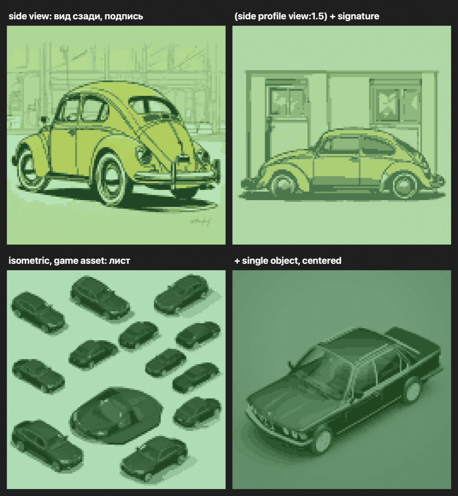

# Урок 3. Работа по API

Как запускать граф из скриптов: подставлять значения, ставить серии в очередь и забирать результаты. Граф собирают и отлаживают в интерфейсе, а по API его запускают: сто вариантов за ночь, генерация из кода игры, Claude по просьбе. Граф тот же, меняются только значения.

Все примеры — на графе из урока 2 (Style Prompt → генерация → Pixelate → Tint) с переименованными узлами.

## Термины

| Термин | Что это |
| --- | --- |
| **Формат UI** (`.ui.json`) | граф для интерфейса: узлы с координатами, размерами, группами, проводами |
| **Формат API** (`.api.json`) | граф для выполнения: только узлы, их входы и провода; уходит в `POST /prompt` |
| **id узла** | ключ узла в формате API (`"5"`); не меняется, пока узел есть в графе |
| **Заголовок** (`_meta.title`) | имя узла в интерфейсе; по нему клиент и скрипты находят, что менять |
| **Провод** | вход вида `["1", 0]` — «выход №0 узла 1» |
| **Задание** | граф, поставленный в очередь; у него `prompt_id` |
| **Очередь** | одна на сервер: туда попадают и запуски из интерфейса, и запуски по API |
| **Клиент** | `client.mjs`: один файл на Node.js без зависимостей, обёртка над API |
| **Рецепт** | граф + значения + seed; при закреплённых версиях даёт ту же картинку байт в байт |

## Два формата графа

| | `.ui.json` | `.api.json` |
| --- | --- | --- |
| Откуда | File → Export, `pull` | File → Export (API), `pull` |
| Что внутри | всё, что видно на холсте | только то, что нужно для выполнения |
| Для чего | открыть в интерфейсе, `push` в Workflows | `run`, `POST /prompt` |

```json
"5": {
  "class_type": "KSampler",
  "_meta": {"title": "Seed"},
  "inputs": {
    "seed": 7, "steps": 25, "cfg": 6,
    "model": ["1", 0],
    "positive": ["2", 0]
  }
}
```

- Вход — либо значение виджета (`"seed": 7`), либо провод (`["1", 0]`).
- Вход, который приходит проводом от другого узла, в `inputs` хранится проводом: у Prompt и Negative текст приходит от Style, поэтому своего `text` у них нет.
- **В API нет `randomize`.** Seed уходит числом, поэтому запуск по API всегда воспроизводим. Новый вариант — новый seed.

## Как забрать граф: `pull`

`pull` берёт не открытую вкладку, а **последний запуск из интерфейса** из истории сервера. Порядок:

1. Поправил граф в интерфейсе (например, переименовал узлы).
2. **Нажал Run** — без запуска граф в историю не попадёт.
3. `node client.mjs pull lesson3 --dir lesson3` → `lesson3/lesson3.ui.json` и `lesson3/lesson3.api.json`.

`--dir` считается от текущей папки. Ответ «в истории нет запусков из интерфейса» — шаг 2 не сделан или сервер перезапускался.

## Заголовки решают

У узлов по умолчанию заголовки вроде `Style Prompt (learn)` и `KSampler`. Работать с ними можно, но писать в командах неудобно, а два узла `KSampler` клиент не различит. Перед экспортом переименуй узлы, которые будешь менять из скриптов (двойной щелчок по заголовку):

| Узел | Заголовок | Что меняем |
| --- | --- | --- |
| Style Prompt | `Style` | `subject`, `style` |
| KSampler | `Seed` | `seed` |
| Pixelate | `Pixelate` | `pixel_size`, `colors` |
| Tint | `Tint` | `color`, `strength` |

Заголовки — это **контракт** со скриптами: переименовать такой узел — всё равно что переименовать функцию. Id тоже стабилен, но только пока узел жив: удалил и добавил заново — id новый, а заголовок можно вернуть прежний.

## Способ 1: клиент

```bash
cd playground
export COMFY_URL=http://<IP Windows>:8188
node client.mjs check lesson3/lesson3.api.json
node client.mjs run lesson3/lesson3.api.json --set Style.style=cartoon --set Seed.seed=7 --out lesson3/cartoon
```

`check` проверяет, что на сервере есть все узлы, модели и LoRA графа. Что делает `run`:

1. подставляет значения `--set Узел.вход=значение`, где узел — id или заголовок;
2. отправляет граф в `POST /prompt`;
3. показывает «в очереди», потом «идёт шаг 12/25»;
4. скачивает картинки в `--out` и пишет туда `outputs.json`: что выдал каждый узел.

Значение принимает тип того, что уже стоит в графе: seed остаётся числом, промпт — текстом. В значении с пробелами кавычки — вокруг всего аргумента: `--set "Style.subject=a red mini cooper"`.

| Опция `run` | Для чего |
| --- | --- |
| `--set Узел.вход=значение` | подставить значение |
| `--set-file Узел.вход=файл` | подставить длинный текст из файла, например промпт |
| `--upload Узел=картинка.png` | загрузить картинку с Мака во вход Load Image (скелет позы, эталон) |
| `--upload-folder Узел.вход=папка` | загрузить целую папку и подставить её во вход |
| `--project имя` | в какую подпапку на сервере класть загруженное |
| `--out папка` | куда скачать результат |

Ошибки клиент объясняет до отправки или по ответу сервера:

```
--set Style.style=anime
→ 9 (Style): Value not in list — style: 'anime' not in ['none', 'flat vector', …]

--set Seed.steps=abc
→ 5.steps: нужно число, а не «abc»
```

## Способ 2: штатное API ComfyUI

Клиент — обёртка над несколькими запросами. То же самое вручную, через curl и jq:

```bash
HOST=http://<IP Windows>:8188

# 1. Подставить значения и обернуть граф в {prompt, client_id}
jq --arg style watercolor --argjson seed 11 \
  '.["9"].inputs.style = $style | .["5"].inputs.seed = $seed | {prompt: ., client_id: "learn"}' \
  lesson3/lesson3.api.json > job.json

# 2. Отправить → {"prompt_id": "7f79…", "number": 17, "node_errors": {}}
ID=$(curl -s -X POST $HOST/prompt -H "Content-Type: application/json" -d @job.json | jq -r .prompt_id)

# 3. Ждать: /history/<id> отвечает {}, пока задание не выполнено
until [ "$(curl -s $HOST/history/$ID | jq -r --arg id $ID '.[$id].status.status_str // empty')" = success ]; do sleep 2; done

# 4. Где файл → скачать через /view
F=$(curl -s $HOST/history/$ID | jq -r --arg id $ID '.[$id].outputs["7"].images[0] | "filename=\(.filename)&subfolder=\(.subfolder)&type=\(.type)"')
curl -s -o watercolor.png "$HOST/view?$F"
```

| Запрос | Что делает |
| --- | --- |
| `POST /prompt` | поставить граф в очередь. Неверный граф — `400` с `node_errors` по узлам; во время обучения — `423` |
| `GET /history/<id>` | `{}`, пока задание не выполнено; потом `status` и `outputs` по узлам |
| `GET /view?filename=&subfolder=&type=output` | скачать файл результата |
| `GET /queue` | что выполняется и что ждёт |
| `POST /upload/image` | загрузить входную картинку |
| `GET /object_info/<узел>` | входы узла и допустимые значения |
| `GET /tool/status` | API инструмента: состояние, шаг, видеопамять |

Полный справочник — в [README](../README.md), разделы «Графы через API», «Клиент», «API инструмента».

## Серии

**Из bash** — когда меняется одно значение:

```bash
for s in "flat vector" "pixel art" cartoon watercolor isometric; do
  node client.mjs run lesson3/lesson3.api.json --set "Style.style=$s" --set Seed.seed=7 --out "lesson3/series/$s"
done
```

Пока серия идёт, задания видны в очереди интерфейса: очередь у интерфейса и API одна.

**Из Node** — когда у каждого элемента свой набор значений. Список легко заменить чтением JSON с предметами игры:

```js
// playground/lesson3/batch.mjs; запуск из playground: node lesson3/batch.mjs
import { execFileSync } from "node:child_process";

const cars = [
  { name: "bmw-e30", subject: "a black bmw e30, side view", style: "pixel art", seed: 7 },
  { name: "mini", subject: "a red mini cooper, side view", style: "flat vector", seed: 3 },
  { name: "beetle", subject: "(side profile view:1.5), a yellow vw beetle, from the side, flat profile", style: "cartoon", seed: 12 },
];

for (const car of cars) {
  // Аргументы списком, без оболочки: пробелы и кавычки в промпте не ломают команду
  execFileSync("node", [
    "client.mjs", "run", "lesson3/lesson3.api.json",
    "--set", `Style.subject=${car.subject}`,
    "--set", `Style.style=${car.style}`,
    "--set", `Seed.seed=${car.seed}`,
    "--out", `lesson3/batch/${car.name}`,
  ], { stdio: "inherit" });
}
```

`execFileSync` ждёт конца каждого запуска, так что серия идёт по одной картинке и не забивает очередь.

## Что показала серия



- **Один seed — не одна композиция.** Мелкая правка промпта сохраняет композицию, а смена стиля переписывает промпт сильно, и модель строит сцену заново: разные стили на seed 7 дали разные ракурсы.
- **Слова стиля — тоже промпт.** `game asset` в стиле isometric дал лист из десятка машин: модель видела много листов спрайтов. Помогло `single object, centered` в позитиве и `multiple, many, sprite sheet` в негативе.
- **Негатив ловит только названное.** `text, watermark` не убрали подпись художника в углу, `signature` убрало.
- **Ракурс зависит от формулировки.** `side view` и даже `(side view:1.3)` дали вид сзади в три четверти, другой seed — вид спереди. Сработало `(side profile view:1.5), … from the side, flat profile`. `(слово:1.5)` — вес: больше 1 — сильнее, меньше 1 — слабее; выше 1.5 картинка начинает ломаться.
- **Общее чинится в узле.** `signature` и правка isometric живут в Style Prompt ([prompt.py](nodes/prompt.py)) — один раз для всех вызовов. Ракурс — свойство предмета, его место в `subject`.

## Воспроизводимость

Повторный запуск `batch.mjs` дал файлы, совпадающие с первыми байт в байт (одинаковый sha1). Поэтому:

- в git хранится **рецепт**: граф, значения, seed. Результаты (`out/`) — в `.gitignore`;
- удачный результат, который пошёл в игру, коммитится уже как ассет игры;
- рецепт повторяется, пока закреплены версии ComfyUI, PyTorch и CUDA — это инвариант инструмента.

## Графы в репозитории проекта

Так устроено в Lootlords:

```
art/comfy/
  client.mjs                 копия клиента (обновляется: client.mjs update)
  nodes/                     пакет узлов проекта → push-nodes lootlords
  workflows/
    icon.ui.json             для интерфейса: открыть, поправить
    icon.api.json            для запуска: run, /prompt
art/out/                     результаты, в .gitignore
```

1. **Оба формата рядом и всегда парой.** Правка: открыл `.ui.json` в интерфейсе (перетащить на холст или `push`) → поправил → Run → `pull <имя> --dir art/comfy/workflows` → закоммитил оба файла.
2. **Заголовки — контракт**, их не переименовывают без правки скриптов.
3. **Перед серией — `check`**: отсутствующий узел, модель или LoRA видны за секунду, а не после очереди из ста заданий.

## Упражнения

1. **Переименуй и забери.** Узлы → `Style`, `Seed`, `Pixelate`, `Tint`; Run; `pull lesson3 --dir lesson3`; посмотреть `_meta.title` в `lesson3.api.json`.
2. **Один запуск.** `run` с `--set Style.style=isometric --set Seed.seed=42 --out lesson3/iso`.
3. **Серия стилей** циклом из bash; во время серии посмотреть очередь в интерфейсе.
4. **Ошибки.** Несуществующий стиль, текст вместо числа, `--set Nope.text=x` — прочитать ответы.
5. **Вручную.** Повторить пример с curl и jq, поменяв `subject` у Style.
6. **Серия из Node.** Добавить в `batch.mjs` свою машину и запустить; запустить второй раз и сравнить файлы: `shasum lesson3/batch/*/*.png`.
7. **Ракурс.** Подобрать формулировку и вес, при которых машина стоит строго сбоку на трёх разных seed.

## Частые ошибки

| Симптом | Причина |
| --- | --- |
| `pull` забрал старый граф | после правки не нажат Run в интерфейсе |
| `pull` не нашёл файлы | `--dir` считается от текущей папки |
| `сервер недоступен` | Windows уснула, Docker не запущен или сменился IP; `COMFY_URL` задан в другом окне терминала |
| клиент не различает узлы | два узла с одинаковым заголовком — переименовать или указать id |
| `423` | идёт обучение LoRA; генерация вернётся после него |
| `400`, `value_not_in_list` | значения нет в списке: стиль, модель или LoRA |
| каждый запуск по API одинаковый | так и задумано: seed — число; нужен новый вариант — новый seed |
| промпт с пробелами разрезался | в bash кавычки вокруг всего `--set "Узел.вход=…"`; в Node — аргументы списком |
