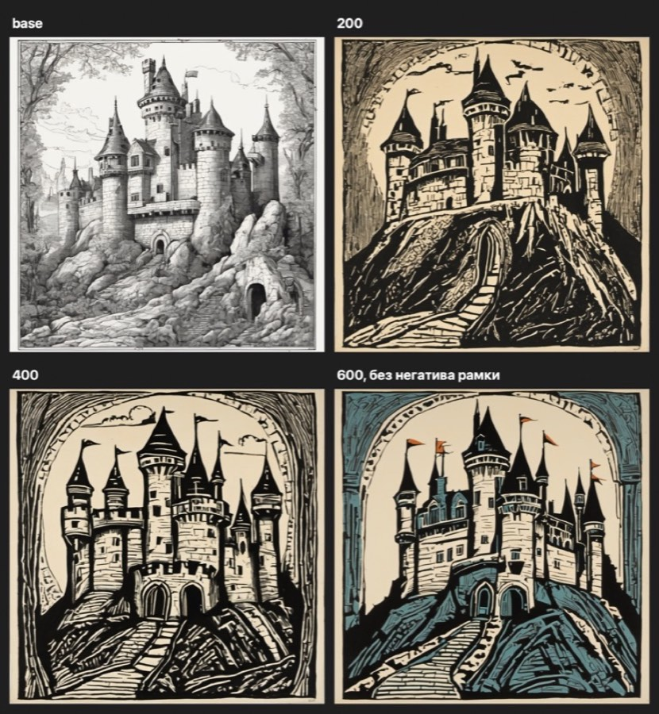
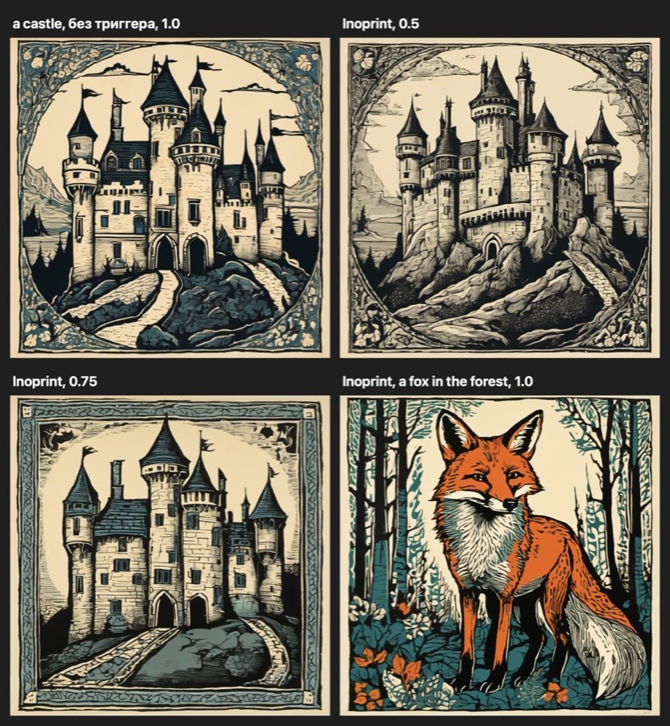
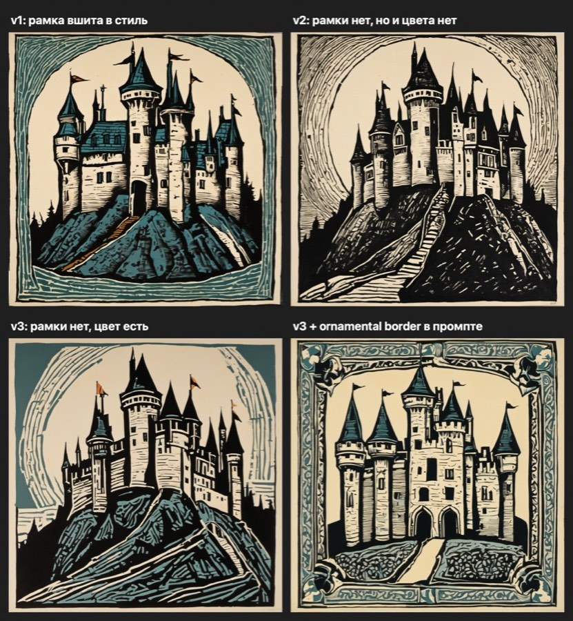

# Урок 4. Обучение LoRA

Как дообучить модель под свою задачу: собрать датасет, подписать его, обучить LoRA, выбрать точку и подключить в граф. Пример урока — учебный стиль «линогравюра в бирюзе и оранжевом» (`learn/linocut`), обученный в три версии: каждая исправляет ошибку предыдущей.

## Термины

| Термин | Что это |
| --- | --- |
| **LoRA** | маленькая надстройка к базовой модели (у нас 85 МБ против 6,9 ГБ): сдвигает её поведение, саму базу не меняет |
| **Датасет** | картинки, на которых учат LoRA, с подписями к каждой |
| **Подпись** (caption) | `.txt` с тем же именем, что у картинки: что на ней изображено |
| **Триггер** | бессмысленное слово в начале каждой подписи (`lnoprint`); в него уходит то, что в подписях не названо |
| **Шаг** | одна картинка датасета прошла через обучение (batch 1) |
| **Повторы** (`repeats`) | сколько раз каждая картинка встречается за эпоху |
| **Эпоха** | проход по всему датасету: картинок × повторов шагов |
| **Сохранение** | промежуточная версия LoRA каждые `save_every` шагов |
| **Strength** | сила LoRA в графе: 0 — выключена, 1 — полностью |
| **Недообучение** | стиль слабый или неполный |
| **Переобучение** | картинка «пережигается»: промпт не слушается, композиции одинаковые, в картинки протекает датасет |
| **UNet** | часть модели, которая рисует; текстовый кодировщик (CLIP) переводит промпт в числа |

## Зачем LoRA, если есть промпт

Стиль из промпта «плывёт»: слово в промпте, seed или предмет меняют картинку (урок 3). LoRA даёт:

- **постоянство** — один стиль на сотне разных предметов;
- **одно слово вместо тридцати** — триггер заменяет длинный промпт стиля;
- **то, чего база не знает** — свой стиль рисования, свой персонаж.

| Что учим | Датасет | Подписи |
| --- | --- | --- |
| стиль | одна манера, разные предметы, композиции, фоны | что изображено; о стиле ни слова |
| персонаж или предмет | один персонаж в разных позах, одежде, местах | фон, поза, одежда; постоянные черты не описываем |

## Датасет

- **15–30 картинок.** Качество важнее количества: одна неудачная заметно портит результат.
- **То, чему учим, одинаково; всё остальное разное.** На всех картинках меч — LoRA решит, что стиль — это меч.
- **Около 1024 px**; квадрат не обязателен — тренер раскладывает по пропорциям.
- **Картинка должна совпадать с подписью.** Подпись «наковальня» под быком учит неправде.
- **Похожие композиции тянут к себе.** Пять круглых мандал из двадцати — и LoRA рисует мандалы.

## Подписи — главное правило

**Что описано в подписи — модель считает изменяемым. Что не описано — впитывает в триггер.**

И следствие, которое показала v2: **подпись забирает из триггера не только названное, но и всё, что в датасете всегда рядом с ним.** Если два признака ходят парой, модель их не разделит — нужны картинки, где они встречаются порознь.

```
dataset/
  sword.png   sword.txt   →  lnoprint, a sword, ornamental border
  fish.png    fish.txt    →  lnoprint, a fish
  hammer.png  hammer.txt  →  lnoprint, a hammer, sunburst background
```

Описываем то, что видно и меняется от картинки к картинке: предмет, рамку, фон. Не описываем то, что должно уйти в стиль: манеру, фактуру, палитру предмета.

Триггер — бессмысленное слово: у базы нет о нём своих представлений. С обычным (`linocut`) LoRA смешалась бы с тем, что база уже знает о линогравюре.

## Параметры

| Параметр | По умолчанию | Смысл |
| --- | --- | --- |
| `steps` | 1500 | всего шагов |
| `repeats` | 10 | повторов каждой картинки за эпоху |
| `save_every` | 250 | как часто сохранять промежуточную версию |
| `rank` | 16 | ёмкость LoRA: больше — запоминает больше и быстрее переобучается |
| `alpha` | `rank / 2` | масштаб обучения LoRA; обычно не трогаем |
| `learning_rate` | 0.0001 | размер шага; обычно не трогаем |
| `resolution` | 1024 | под SDXL |
| `seed` | 42 | тот же датасет и параметры — та же LoRA |

Арифметика: 20 картинок × 10 повторов = 200 шагов на эпоху; 600 шагов — 3 эпохи. RTX 3080 — около 1,3 с на шаг: 600 шагов — около 13 минут плюс минута на старт. Меньше картинок при тех же шагах — больше эпох: каждая картинка видна чаще.

## Как идёт обучение

```bash
node client.mjs train learn/linocut lesson4/dataset --trigger lnoprint --params '{"steps": 600, "save_every": 200}'
```

- Клиент проверяет, что у каждой картинки есть непустая подпись (`--trigger` — что она начинается с триггера), собирает zip и отправляет в `POST /tool/train`.
- Версия добавляется сама: `learn/linocut-v1`, `-v2`… Отменённое обучение номер не занимает.
- Пока идёт обучение, **любая генерация получает `423`** — и из интерфейса, и по API: генерация и обучение вместе не помещаются в видеопамять.
- Тренеру нужно 8,5 ГБ свободной видеопамяти: на Windows не держать открытыми браузер, Discord, Telegram и подобное.
- Отмена — `node client.mjs train-cancel`: задание `cancelled`, в библиотеку ничего не попадает.

В библиотеке после обучения:

```
learn/linocut-v3                                  финал
learn/linocut-v3/linocut-v3-step00000200          промежуточные сохранения
learn/linocut-v3/linocut-v3-step00000400
learn/linocut-v3/linocut-v3-step00000600
```

## Выбор точки

Один промпт, один seed, разные сохранения — отличие только в шагах. Промпт — с предметом, которого нет в датасете: так видно, переносит ли LoRA стиль на новое.



- **base** — та же картинка без LoRA (strength 0).
- **200, 400** — резьба и бумага уже есть, цвета нет.
- **600** — появилась палитра: модель учит сначала крупное (манеру, фактуру), потом детали.

Нужна **самая ранняя точка, где стиль держится, а промпт ещё слушается.** Признаки пережога — композиции одинаковые, промпт игнорируется, в картинки протекают детали датасета. Где он начинается, видно, только если учить дольше.

Сравнение делает скрипт: берёт сохранения версии из библиотеки и запускает граф `txt2img-lora` с каждым.

```js
// node lesson4/compare.mjs learn/linocut-v3 "lnoprint, a castle"
const runs = [
  { label: "base", lora: version, strength: 0 },
  ...saves.map((name) => ({ label: name.split("-step")[1], lora: name, strength: 1 })),
  { label: "final", lora: version, strength: 1 },
];
for (const run of runs) {
  execFileSync("node", ["client.mjs", "run", "lesson4/txt2img-lora.api.json",
    "--set", `Prompt.text=${prompt}`,
    "--set", `LoRA.lora_name=${run.lora}.safetensors`,
    "--set", `LoRA.strength_model=${run.strength}`,
    "--set", `KSampler.seed=${seed}`,
    "--out", `lesson4/compare/${run.label}`], { stdio: "inherit" });
}
```

## LoRA в графе

В интерфейсе: меню → Browse Templates → **local-comfyui** → **`txt2img-lora`**. Узел **LoRA** стоит между Load Checkpoint и остальными; в `lora_name` — вся библиотека (новая версия появится после обновления страницы). По API — `node client.mjs workflow txt2img-lora`.



- **strength 0.5** — гравюра без цвета; **0.75** — цвет есть, стиль мягче; **1.0** — полностью.
- **Лиса** — палитра переносится, оранжевый появляется там, где он уместен: LoRA выучила палитру, а не «покрась всё оранжевым».
- **Без триггера стиль почти полный.** Наш тренер учит только UNet (`--network_train_unet_only`, так обучение помещается в 10 ГБ). Поэтому:
  - LoRA действует на любой промпт, пока подключена; выключают её `strength 0` или убирают узел, а не триггер;
  - `strength_clip` у наших LoRA ни на что не влияет — работает `strength_model`.

## Три версии: как подписи решили результат



| Версия | Что меняли | Итог |
| --- | --- | --- |
| v1 | 20 картинок, в подписях только предмет | стиль есть, но рамка — на всех картинках датасета и ни в одной подписи — вшита в стиль: негатив её не убирает |
| v2 | убрали 6 неудачных картинок, подписали рамку (`ornamental border`, `thin frame`, `patterned background`) | рамка управляется негативом, но пропал цвет: бирюза в датасете жила в рамках и ушла вместе с ними |
| v3 | добавили 6 картинок без рамки, где бирюза и оранжевый в самом предмете | стиль и цвет — от триггера, рамка — по желанию |

Параметры у всех трёх одинаковые — менялись только датасет и подписи.

Добор для v3 генерировался так: цвет в предмете, рамки нет, в подписи — только предмет и фон.

```js
const STYLE = "linocut print, bold carved black outlines, object inked in teal and orange, " +
  "plain cream paper background, no border, single object, centered";
const NEGATIVE = "photo, realistic, 3d render, gradient, blurry, text, watermark, signature, multiple, " +
  "border, frame, ornament, pattern";
// подпись: `lnoprint, a fish` — цвет не называем, он должен уйти в триггер
```

## Датасет синтетический — и чем это отличается от настоящего

Учебный датасет рисовала сама SDXL длинным промптом. Для учёбы это удобно: стиль заранее известен, LoRA сжимает 25 слов в одно и делает стиль постоянным. Но генерация переносит в датасет свои ошибки (мандалы, бык вместо наковальни), а научить базу тому, чего она не умеет, так нельзя. Настоящий датасет — отобранные эталоны: в Lootlords это 20–30 картинок стайлгайда в `art/` (Git LFS), обученная LoRA — в GitHub Releases, на Windows — в библиотеке `lootlords/`.

## Упражнения

1. **Датасет.** `node lesson4/dataset.mjs` — 20 картинок с подписями; просмотреть все и отсеять неудачные вместе с `.txt`.
2. **Обучение.** `train` с 600 шагами и `save_every` 200; во время обучения нажать Run в интерфейсе и увидеть `423`.
3. **Точка.** `compare.mjs` на предмете не из датасета; выбрать сохранение.
4. **Strength и триггер.** 0.5 / 0.75 / 1.0; промпт без триггера.
5. **Подписи (v2).** Подписать рамку и убедиться, что негатив её убирает; найти, что ещё ушло вместе с ней.
6. **Развести признаки (v3).** Добавить картинки, где цвет есть без рамки; сравнить v2 и v3 на одном seed.
7. **Пережог.** Обучить 1500 шагов с `save_every` 250 и найти, где картинка начинает «гореть».
8. **Уборка.** `node client.mjs lora rm learn/linocut-v1` — удаляет версию вместе с её сохранениями.

## Частые ошибки

| Симптом | Причина |
| --- | --- |
| `нет подписи …txt`, `пустая подпись` | у картинки нет `.txt` с тем же именем или он пустой |
| `начинается не с «…»` | подпись без триггера при `--trigger` |
| `409` при запуске обучения | очередь генерации не пуста |
| `503` «видеокарту держит что-то кроме ComfyUI» | на Windows открыта программа, занимающая видеопамять |
| `423` при генерации | идёт обучение; отменить — `train-cancel` |
| новой версии нет в списке `lora_name` | не обновлена страница |
| стиль слабый | мало шагов, или strength меньше 1 |
| деталь датасета (рамка, фон) на всех картинках | она есть на всех картинках и не названа в подписях |
| после подписи пропало что-то ещё | оно в датасете всегда рядом с подписанным — добавить картинки, где они порознь |
| стиль работает и без триггера | так и есть: тренер учит только UNet; выключать — strength 0 |
| `strength_clip` ничего не меняет | у наших LoRA нет весов текстового кодировщика |
